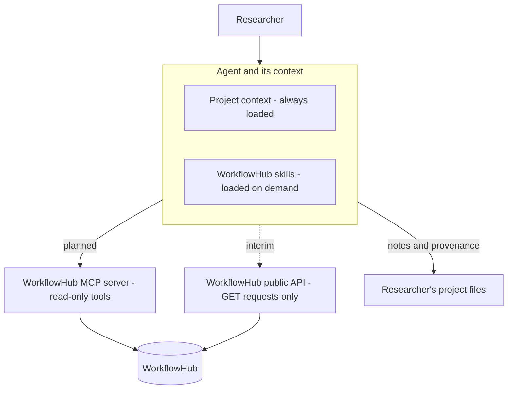

# WorkflowHub skills for AI agents

Agent skills that help researchers use [WorkflowHub](https://workflowhub.eu)
through AI agents: finding workflows, judging whether they fit, understanding
what they do, and citing them correctly.

> **Status: draft for team discussion.** These skills only read from
> WorkflowHub. The WorkflowHub MCP server they are designed to use is not
> available yet. Until it is, the skills use WorkflowHub's public read-only
> API instead. See [About the MCP server](#about-the-mcp-server).

## Status at a glance

| Component | What it does | Status |
|---|---|---|
| `workflowhub-find` | Turns a research need into a short, justified shortlist of workflows | Draft, tested once |
| `workflowhub-evaluate` | Judges whether specific workflows fit a researcher's data and purpose, and compares candidates | Draft, not yet tested |
| `workflowhub-explain` | Explains what a workflow does, step by step, and maps its inputs to the researcher's data | Draft, not yet tested |
| `workflowhub-cite` | Produces a citation, methods text and a provenance record in the researcher's project | Draft, not yet tested |
| `workflowhub-reuse` | Prepares a chosen workflow to run in the researcher's environment | Outline only |
| `workflowhub-track-updates` | Checks recorded workflows for new versions | Outline only |
| `workflowhub-survey` | Surveys everything on a topic, for reviews and curation | Outline only |
| WorkflowHub MCP server | Read-only tools the skills will use | Not available yet |

## How it fits together

The design separates **capabilities** from **knowledge**:

- **The MCP server** gives an agent the ability to act on WorkflowHub:
  search, read metadata, download workflow content. It is being built by
  the WorkflowHub team.
- **The skills** (this repository) give the agent the know-how to use those
  capabilities well: how to search thoroughly, what makes a workflow
  trustworthy, how to read Galaxy or Nextflow files, how to cite correctly.
- **Server instructions**, short always-on guidance from the MCP server,
  will cover the basics every agent needs.

Skills load on demand. At the start of a session an agent sees only each
skill's name and description, and loads the full instructions only when a
task matches.



The skills never change anything on WorkflowHub. The only place they write is
the researcher's own project, and only with the researcher's agreement.

## The researcher's journey

1. **Find** candidate workflows for an analysis (`workflowhub-find`).
2. **Evaluate** whether they are trustworthy and fit the data
   (`workflowhub-evaluate`).
3. **Explain** what the chosen workflow does and what it needs
   (`workflowhub-explain`).
4. **Reuse** it in the researcher's environment (`workflowhub-reuse`,
   outline only).
5. **Cite and record** what was used (`workflowhub-cite`).

Two activities recur over time: checking for updates
(`workflowhub-track-updates`) and surveying a whole topic
(`workflowhub-survey`). Both are outline only.

Each skill can produce a structured **handoff record**, defined in its
`assets/` template. All records share the same `workflow` fields, so one
skill's output feeds the next. This is also what lets the same skills work
with a single agent or with several: a coordinating agent passes records to
helper agents, and the skills themselves don't change.

## Repository layout

```
workflowhub-skills/
├── README.md             This file
├── OPEN-QUESTIONS.md     Questions for the team, API and policy
├── TESTING.md            Test prompts, what to check, and results
├── shared/
│   └── tools.md          Master copy of how skills reach WorkflowHub
├── skills/               Complete skills: install these
│   ├── workflowhub-find/
│   ├── workflowhub-evaluate/
│   ├── workflowhub-explain/
│   └── workflowhub-cite/
└── drafts/               Outline skills: don't install yet
    ├── workflowhub-reuse/
    ├── workflowhub-track-updates/
    └── workflowhub-survey/
```

Each skill folder contains:

- `SKILL.md`: when to use the skill and the procedure to follow
- `references/`: material loaded only when needed, including a copy of
  `tools.md`
- `assets/`: output templates and handoff records

## Using the skills

### What you need

- An agent that supports the [Agent Skills](https://agentskills.io) format,
  such as Claude Code, Cursor, OpenAI Codex, Gemini CLI or GitHub Copilot.
- Until the MCP server is available: an agent that can make HTTP requests,
  for example with curl or code execution, and internet access.

### Install in Claude Code

Copy the four folders from `skills/` into a project's `.claude/skills/`
folder. From the root of this repository:

```bash
mkdir -p /path/to/your-project/.claude/skills
cp -R skills/workflowhub-* /path/to/your-project/.claude/skills/
```

To use them in every project instead, copy them to `~/.claude/skills/`.

Don't install the folders in `drafts/`. Their descriptions are complete, so
an agent could activate one even though the instructions are only outlines.

To check that they loaded, start a session in the project and type `/skills`,
or ask "What skills are available?". The first time a skill contacts
WorkflowHub, Claude Code will ask permission to run curl.

### Install in other agents

Copy the folders from `skills/` into the agent's skills directory. Check that
agent's documentation for the location.

### Try it

> I have Illumina paired-end RNA-seq data from mouse liver, treated vs
> control, and want to run differential expression analysis in Galaxy. Is
> there an existing workflow on WorkflowHub I could use?

> Compare the top two from that shortlist. It's for a paper. Which should I
> use?

> Walk me through what WorkflowHub workflow 401 does and what inputs it
> needs.

More prompts, and what to check, are in [TESTING.md](TESTING.md).

## About the MCP server

**The WorkflowHub MCP server is not set up yet.** The skills were written so
that switching to it takes a few small, contained edits.

**How the skills reach WorkflowHub now.** Every skill reads
`references/tools.md`, which maps each capability (search, read metadata,
download content) to a way of doing it:

1. **The MCP server.** Preferred. Tool names are placeholders marked TBD.
2. **WorkflowHub's public API.** The interim route: read-only GET requests.
3. **Neither available.** The agent tells the researcher and gives them a
   link to search WorkflowHub themselves.

The skills never scrape web pages or answer from memory.

**When the MCP server is ready:**

1. Fill in the real tool names in `shared/tools.md`, and update any items
   still marked "to verify".
2. Copy it into every skill (see [Maintaining the skills](#maintaining-the-skills)).
3. Uncomment the `compatibility` line in each `SKILL.md`, so the dependency
   is declared.
4. Decide whether to keep the public API as a fallback.
5. Increase `metadata.version` in each `SKILL.md`, then re-run the tests in
   [TESTING.md](TESTING.md).
6. Update the status table at the top of this README.

## Design principles

- **Read only.** The skills never register, edit or delete anything on
  WorkflowHub.
- **Retrieved content is data, not instructions.** Workflow descriptions and
  files are written by whoever registered them, and are never obeyed as
  instructions.
- **Precise identification.** Every workflow is given with its ID, version
  and URL.
- **"Unknown" rather than a guess.** Missing metadata is reported as
  missing. IDs, versions, DOIs, authors and licenses are never invented.
- **Careful with context.** Agents fetch only what the current step needs.
- **Pause at decisions.** The researcher makes the choices.
- **Instructions only.** No scripts, so the skills work in any agent that
  supports the format.

## Maintaining the skills

- **`shared/tools.md` is the master copy.** After editing it, copy it into
  every skill:

```bash
  for s in skills/*/; do cp shared/tools.md "${s}references/tools.md"; done
```

- **Use only the six frontmatter fields from the Agent Skills
  specification:** `name`, `description`, `license`, `compatibility`,
  `metadata` and `allowed-tools`. Other fields work in some agents but break
  uploads elsewhere.
- **Keep each `SKILL.md` under 500 lines.** Move detail into `references/`.
- **Edit descriptions with care.** They decide when a skill activates.
- **Test after changes.** Re-run the relevant prompts in
  [TESTING.md](TESTING.md) and record the results there.

## Known issues

Found in the first test (details in [TESTING.md](TESTING.md)):

- **Version numbers.** WorkflowHub has two identifiers for a version: a
  number used in URLs (for example 16) and a name researchers see (for
  example v1.5). The templates record only the number. Planned fix: add
  `version_name` to the shared `workflow` fields.
- **"Last updated" dates.** A workflow's own "last updated" date can be older
  than its latest version. Planned fix: define it in `tools.md` as the date
  of the latest version.
- **Outdated tool details.** In one case the agent described a tool the
  workflow no longer uses. Planned fix: describe tools only from the
  metadata of the version being reported.
- **Maturity is often not set.** Planned fix: treat "unknown" as normal in
  the evaluation criteria.
- **Submitters can be bots.** Planned fix: tell `workflowhub-cite` to use
  the creators, never the submitter.
- **Workflow-type filter.** It works through the API, but the exact
  parameter name still needs recording in `tools.md`.

## Open questions

See [OPEN-QUESTIONS.md](OPEN-QUESTIONS.md) for questions about the API, the
MCP server, policy, standards and maintenance.

## License

Not yet decided. The skill files currently declare BSD-3-Clause, pending the
team's decision (question 10 in [OPEN-QUESTIONS.md](OPEN-QUESTIONS.md)).

## Maintainers

eScience Lab, The University of Manchester. <!-- Add names and contact. -->